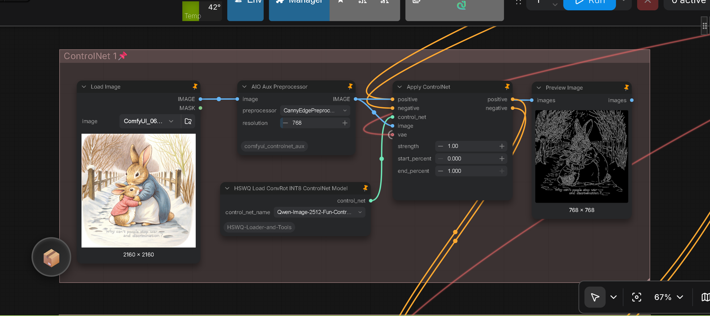
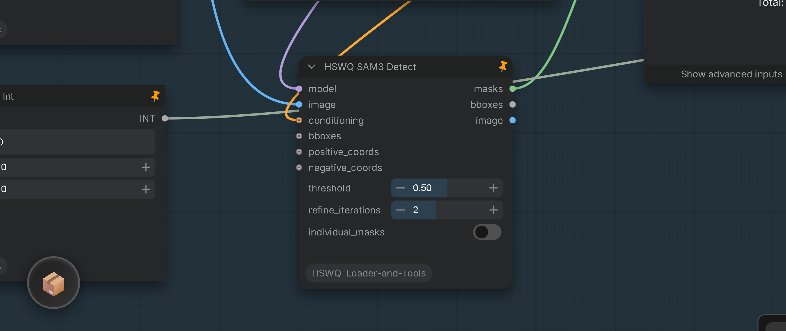

# ComfyUI-HSWQ-ConvRot-INT8/ConvRot-NVFP4-Loader-and-Tools

<table align="center">
  <tr>
    <td align="center" bgcolor="#e5e7eb" width="88" height="36"><a href="../README.md"><font color="#4b5563"><b>EN</b></font></a></td>
    <td align="center" bgcolor="#d4465e" width="88" height="36"><font color="#ffffff"><b>中文</b></font></td>
  </tr>
</table>

<p align="center">

</p>

## 概述

本自定义节点包用于加载和运行 **[Hybrid-Sensitivity-Weighted-Quantization (HSWQ)](https://github.com/ussoewwin/Hybrid-Sensitivity-Weighted-Quantization)** 量化包以及相关的 ComfyUI 兼容 SDXL / Z Image 量化权重。

**HSWQ**（量化方法、脚本与上游文档）是 **ussoewwin 的原创作品**，另以 **GNU Affero General Public License v3（AGPL-3.0）** 发布于 [ussoewwin/Hybrid-Sensitivity-Weighted-Quantization](https://github.com/ussoewwin/Hybrid-Sensitivity-Weighted-Quantization)。本 ComfyUI 加载器包为相关但**独立**的仓库（许可见下文）。

HSWQ 是面向扩散 UNet 的高保真量化方案。当前公开的 HSWQ 工作聚焦于 **SDXL** 的 **ConvRot INT8**（reverse hybrid），以及 **Z Image / ZIT** UNet 的 **ConvRot NVFP4**、**Krea2** UNet 的 **ConvRot INT8**。SDXL ConvRot INT8（reverse hybrid）以 FP16 检查点为唯一输入；按层的 **trajectory-impact** 排名把 **K 个影响最低的层**打包为 **FULL ConvRot INT8**，其余所有层保持 FP16 —— 不是按 keep ratio 百分比保留的方案。

| 路径 | 在本仓库中的定位 |
| :--- | :--- |
| **HSWQ ConvRot INT8 (SDXL, reverse hybrid)** | ComfyUI `int8_tensorwise` 包（K 个影响最低的层 → FULL ConvRot INT8，其余所有层保持 FP16；不内嵌 VAE —— 请用单独的 SDXL VAE 解码）；通过 **HSWQ Checkpoint Loader** 加载（`weight_dtype`：`int8_tensorwise` / INT8 自动检测）。以确定性 25-seed latent-trajectory gate 验证（cosine mean ≥ 0.95，0/25 bifurcated）。**仅支持由 [Hybrid-Sensitivity-Weighted-Quantization](https://github.com/ussoewwin/Hybrid-Sensitivity-Weighted-Quantization) 量化的模型。** |
| **HSWQ ConvRot NVFP4 (Z Image / ZIT)** | ComfyUI `nvfp4` UNet 包（常见为 Linear NVFP4 + INT8 protect；以 reverse method 构建 —— 影响最低的层先转换）；通过 **HSWQ ConvRot INT8/ConvRot NVFP4 UNet Loader** 加载（`weight_dtype`：`Z Image ConvRot NVFP4`，或 `default` 触发 NVFP4 自动检测）。走与 `hswq/benchmark` 一致的 **Comfy parity** 路径（stock GEMM + online act rotate）。以确定性 20-seed latent-trajectory gate 验证（cosine mean ≥ 0.95，0/20 bifurcated）。**仅支持由 [Hybrid-Sensitivity-Weighted-Quantization](https://github.com/ussoewwin/Hybrid-Sensitivity-Weighted-Quantization) 量化的模型。** |
| **HSWQ ConvRot INT8 (Krea2)** | ComfyUI `int8_tensorwise` UNet 包（Krea2 包带 `txtfusion.projector`）；通过 **HSWQ ConvRot INT8/ConvRot NVFP4 UNet Loader** 加载（`weight_dtype`：`int8_tensorwise`，或 `default` 触发 INT8 自动检测）。HSWQ 流程：结构黑名单保护（`first.` / `last.` / `mod.` / `norm` / `projector` / `txtfusion`）+ 4 轴复合排名；省略 bias 校正（`1off`）。Krea2 走 stock-equivalent 的 ConvRot INT8 加载（不做 Z Image parity），并且是**唯一在 DisTorch2 加载器下验证过的 `weight_dtype`**。**仅支持由 [Hybrid-Sensitivity-Weighted-Quantization](https://github.com/ussoewwin/Hybrid-Sensitivity-Weighted-Quantization) 量化的模型。** |
| **Krea2 ConvRot NVFP4** | HSWQ 专属的 Krea2 ConvRot NVFP4 开发 / 支持**已结束**。`Krea2 ConvRot NVFP4` 加载选项与 Krea2 NVFP4 加载/前向运行时代码已从本包移除；Krea2 继续支持上方的 **ConvRot INT8**（见上一行） |
| **FP8 (E4M3)** | HSWQ **FP8 开发已结束**（技术文档仍保留在上游）。只要 ComfyUI 支持，这里的加载器仍可接受现有的 FP8 权重 |
| **Z Image 8-bit** | HSWQ 专属的 Z Image INT8 开发 / 发布**已结束**。Z Image 推荐使用**原生 ConvRot INT8**（通常 SSIM > 0.99）。HSWQ INT8 仅继续用于 **SDXL**。**Z Image ConvRot NVFP4** 由上方的 UNet 加载器支持 |

上游 HSWQ 验证（参考）：质量以**确定性 latent-trajectory 比较**为 gate（逐步 cosine + bifurcation；旧解码 SSIM 分数是被 VAE 解码掩盖的假象，已不再使用）—— **SDXL ConvRot INT8 (reverse hybrid)：cosine mean ≥ 0.95（25 seeds）**、**Krea2 ConvRot INT8：cosine mean ≥ 0.98（25 seeds）**、**Z Image Hybrid ConvRot NVFP4：cosine mean 0.96–0.97（20 seeds）** —— 文件体积比 FP16 减小约 **29–40%**，同时保持与标准 ComfyUI 加载器兼容。

**量化脚本、使用说明与基准测试：** [ussoewwin/Hybrid-Sensitivity-Weighted-Quantization](https://github.com/ussoewwin/Hybrid-Sensitivity-Weighted-Quantization)

**已发布的 HSWQ SDXL 模型（ConvRot INT8）：** [Hugging Face — Hybrid-Sensitivity-Weighted-Quantization-SDXL-ConvRot-INT8](https://huggingface.co/ussoewwin/Hybrid-Sensitivity-Weighted-Quantization-SDXL-ConvRot-INT8)

**已发布的 HSWQ Z Image / ZIT 模型（ConvRot NVFP4）：** [Hugging Face — Hybrid-Sensitivity-Weighted-Quantization-Z-Image-Hybrid-ConvRot-NVFP4](https://huggingface.co/ussoewwin/Hybrid-Sensitivity-Weighted-Quantization-Z-Image-Hybrid-ConvRot-NVFP4)

<p align="center">

</p>

## 通用工作流要求：VRAM 清理（适用于所有 HSWQ 模型与节点）

> [!IMPORTANT]
> **所有 HSWQ 工作流的强制要求（ConvRot INT8 / ConvRot NVFP4）：**
> 在使用任何 HSWQ 模型或节点（SDXL 检查点、UNet 加载器、ControlNet、Model Patch 等）的工作流中，**务必在工作流末尾放置来自 [ComfyUI-DistorchMemoryManager](https://github.com/ussoewwin/ComfyUI-DistorchMemoryManager) 的 General Purge VRAM V2，并开启其 `HSWQ` 开关**。
>
> 若工作流中使用了 **Model Patch Loader**（例如用于 ControlNet / 特征投影器的 HSWQ Model Patch Loader），还**必须同时将 General Purge VRAM V2 的 `clear_model_patches`（清理模型补丁）开关保持开启（ON）**。
>
> 此要求**不局限于某个单一加载器或节点**，而是**贯穿所有 HSWQ 运行的通用必备要求**。HSWQ 残留的 GPU/host 内存、NVFP4 运行时执行池、Tensor Core 工作区以及 CUDA graphs 无法被 ComfyUI 的常规模型卸载机制完全释放。若工作流末尾缺少该清理节点，在第一次生成之后的后续生成中可能会直接报错失败（例如 `quantize_nvfp4` / `PyCapsule` / `pooled TC path failed`）。

## 安装

### 快速安装

将本仓库克隆到 ComfyUI 的 `custom_nodes` 目录：

```bash
# Windows
git clone https://github.com/ussoewwin/ComfyUI-HSWQ-Loader-and-Tools "%USERPROFILE%\ComfyUI\custom_nodes\ComfyUI-HSWQ-Loader-and-Tools"

# Linux/Mac
git clone https://github.com/ussoewwin/ComfyUI-HSWQ-Loader-and-Tools ~/ComfyUI/custom_nodes/ComfyUI-HSWQ-Loader-and-Tools
```

重启 ComfyUI 以加载节点。

## 节点

### HSWQ Checkpoint Loader


面向 **SDXL** 与 **SD1.5** 模型的高性能统一检查点加载器，提供可选设备分配、针对各架构深度定制的 **ConvRot INT8** 精度流水线，以及整 denoiser **CUDA-Graph replay** 执行加速。使用方式与标准 ComfyUI Load Checkpoint 节点一致；仅输出 **MODEL** 与 **CLIP**（Latent 解码请使用独立的 VAE 加载器）。

**SDXL ConvRot INT8** 与 **SD1.5 ConvRot INT8** **仅支持由 [Hybrid-Sensitivity-Weighted-Quantization](https://github.com/ussoewwin/Hybrid-Sensitivity-Weighted-Quantization) 量化的模型**。其他第三方量化包不在支持范围内。

#### 针对架构的专属量化流水线

- **SD1.5 ConvRot INT8（`weight_dtype`：`SD1.5 ConvRot INT8`）**：
  - **内置于 `nodes/sd1.5 int8/` 的完整运行时栈**：与基准仓库主干实现 byte 级完全一致（4 副本 SHA256 校验一致）。
  - **Triton 融合 ConvRot W8A8 IMMA Conv2d 算子**（`_int8_conv_rot_imma`）：将 gather-quant、8 向 Hadamard 激活旋转以及 IMMA GEMM 融合进单个 GPU 核函数中执行。
  - **整 denoiser CUDA-Graph Replay 执行器**（`_Sd15CudaGraphExecutor`）：捕获前将权重完全驻留化（staticize-for-capture，消除捕获期间的内存分配抖动）、fail-fast 激活检测（超出静态捕获尺寸范围立即抛出异常）、并在默认 PyTorch 缓存分配器下支持单次捕获级别（per-capture）的 Triton 回退。
  - **Double-Arm 双重激活防护**（`_hswq_sd15_graph_armed`）：防止多模块别名导入导致的底层模型二次包装，彻底杜绝流捕获失效（`cudaErrorStreamCaptureUnsupported 900`）。
  - **CLIP 严格保持 FP16**：内嵌的 CLIP 文本编码器严格保持为 FP16，确保文本条件特征完全无损（与 FP16 基线对比余弦相似度 0.99987）。
  - **生产实测性能（512x512，RTX 5060 Ti）**：稳态速度 **17.18–17.34 it/s 对比 FP16 15.03–15.22 it/s（+14.5%）**，单 seed 平均耗时从 1.72 s 降至 1.50 s（+12.8%）。

- **SDXL ConvRot INT8（`weight_dtype`：`SDXL ConvRot INT8`）**：
  - **反向混合敏感度排序（Reverse Hybrid Ranking）**：将影响度最低的 $K$ 层打包为 FULL ConvRot INT8，敏感层保持 FP16，严格保障潜空间轨迹保真度（25 个随机 seed 下余弦平均值 $\ge 0.95$，0/25 分叉）。
  - **Conv2d 量化作用域与 MixedPrecisionOps**：打补丁扩展 Conv2d 量化加载，使 UNet 卷积层能够正常反量化与计算，避免梯度或张量类型报错。
  - **SDXL CLIP INT8 元数据消费**：自动消费内嵌的 `clip_l` 与 `clip_g` ConvRot INT8 标定元数据（`arm_sdxl_clip_quant_metadata`）。
  - **整 denoiser CUDA Graph 加速**（`_arm_sdxl_cudagraph`）：整图捕获与回放执行，加速稳态采样，并在异常时自动回退至 pooled-rotate eager 路径。
  - **向后兼容**：旧工作流中指定的 `weight_dtype` = `int8_tensorwise` 会自动路由至该路径。

- **标准 / 自动识别（`weight_dtype`：`default`）**：
  - 对标准 FP16 / FP8 检查点调用 `load_checkpoint_guess_config`。
  - 通过 `checkpoint_looks_like_comfy_quant_int8` 自动探测 safetensors 元数据：若检测到 comfy_quant INT8 标记，则直接路由至专用 INT8 执行路径。
  - 遗留的 comfy_quant NVFP4 检查点也会自动识别并路由至 NVFP4 兼容层。

#### 特性

- **多架构检查点加载**：从标准 SDXL 或 SD1.5 检查点同时加载 UNet（MODEL）与 CLIP
- **明确的 `weight_dtype` 路由**：UI 下拉项提供 `default`、`SDXL ConvRot INT8` 以及 `SD1.5 ConvRot INT8`
- **设备选择**：可选设备参数，用于显式指定 GPU（如 `cuda:0`、`cuda:1`）或 CPU
- **CUDA Graph 加速**：同时为 SD1.5 与 SDXL 架构内置整 denoiser CUDA Graph 执行器
- **标准 ComfyUI 集成**：无缝对接下游采样器、Conditioning 及 LoRA 节点

#### 使用说明

- **输入**：
  - `ckpt_name`：`models/checkpoints` 目录下的检查点文件名
  - `weight_dtype`：精度模式 — `default`（自动识别 / FP16）、`SDXL ConvRot INT8` 或 `SD1.5 ConvRot INT8`
  - `device`：目标执行设备（`cuda:0`、`cuda:1` 等）
- **输出**：仅 MODEL 与 CLIP；如需解码请连接独立的 VAE 加载器
- **分类**：Loaders（`loaders`）
- **兼容性**：仅支持使用 [Hybrid-Sensitivity-Weighted-Quantization](https://github.com/ussoewwin/Hybrid-Sensitivity-Weighted-Quantization) 量化的模型
- **INT8 + LoRA**：关于 INT8 LoRA 烘焙及 Status 状态日志详情，请参阅 [`zhmd/HSWQ_INT8_AND_LORA_TECHNICAL_GUIDE.md`](zhmd/HSWQ_INT8_AND_LORA_TECHNICAL_GUIDE.md)
- **VRAM 清理（通用 HSWQ 必备要求）**：如上方通用工作流要求所述，在所有 HSWQ 运行中，请务必在工作流末尾放置来自 [ComfyUI-DistorchMemoryManager](https://github.com/ussoewwin/ComfyUI-DistorchMemoryManager) 的 **General Purge VRAM V2**，并开启其 **`HSWQ`** 开关。

### HSWQ ConvRot INT8/ConvRot NVFP4 UNet Loader


标准 ComfyUI UNet 加载器的封装，用于 `diffusion_models` 下的扩散 UNet（**Z Image / ZIT** 及其他 UNet 包）。以 FP8、INT8 与 **ConvRot NVFP4** 权重类型加载 **MODEL**。

**Z Image / ZIT ConvRot NVFP4** **仅支持由 [https://github.com/ussoewwin/Hybrid-Sensitivity-Weighted-Quantization](https://github.com/ussoewwin/Hybrid-Sensitivity-Weighted-Quantization) 量化的模型**。其他第三方 ConvRot NVFP4 UNet 包不在支持范围内。

- **通用 FP8 / INT8**：与库存 UNet 加载器思路相同（HSWQ FP8 E4M3、Scaled FP8，以及在被选择或自动检测到时使用原生 comfy_quant / `int8_tensorwise`）。这些模式不限于 HSWQ 专属权重。
- **ConvRot NVFP4（Z Image / ZIT）**：将 `weight_dtype` 设为 **`Z Image ConvRot NVFP4`**，或在 UNet safetensors 带有 comfy_quant / HSWQ `nvfp4` 标记时保持 **`default`**。走本扩展 `nodes/nvfp4/` 下的 UNet NVFP4 栈，并使用与 `hswq/benchmark` 一致的 **Comfy parity** 路径（stock MixedPrecision GEMM + online act rotate；保留 ConvRot Linear LoRA bake）。**不要**在此期望 Tensor Core 产品路径——Z Image ConvRot NVFP4 在本 UNet 加载器上走 **Comfy parity** 路径。**仅支持由 [https://github.com/ussoewwin/Hybrid-Sensitivity-Weighted-Quantization](https://github.com/ussoewwin/Hybrid-Sensitivity-Weighted-Quantization) 量化的模型。**
- **INT8 / NVFP4 自动检测**：看起来像 INT8 的包走 INT8 路径；看起来像 NVFP4 的包在 `weight_dtype` 为 `default` 时走 ConvRot NVFP4（NVFP4 分发安装在 INT8 之后，避免混合包被 INT8-only 检测抢走）。

本加载器**不**内置 Triton accelerate 开关。INT8 Linear 的速度由 **ComfyUI + `comfy_kitchen`**（`int8_linear`：cuda → triton → eager）负责。本扩展保留 INT8 **加载兼容** 补丁（Conv2d / LoRA / ControlLora / handoff）以及 `nodes/nvfp4/` 下的 **NVFP4** UNet 补丁。

- **Z Image / ZIT ConvRot NVFP4 兼容性**：**仅限**由 [https://github.com/ussoewwin/Hybrid-Sensitivity-Weighted-Quantization](https://github.com/ussoewwin/Hybrid-Sensitivity-Weighted-Quantization) 量化的 UNet 包

- **VRAM 清理（通用 HSWQ 必备要求）**：与上方通用工作流要求相同 —— 针对所有 HSWQ INT8 与 NVFP4 运行，请在工作流末尾放置来自 [ComfyUI-DistorchMemoryManager](https://github.com/ussoewwin/ComfyUI-DistorchMemoryManager) 的 **General Purge VRAM V2** 并开启 **`HSWQ`**。

### HSWQ ConvRot INT8/ConvRot NVFP4 UNet Loader (DisTorch2)


上述 loader 的 DisTorch2 版本：可将**整个 UNet** 放到显存之外（virtual VRAM + donor device，例如 `cpu`），使超出显存的模型包也能运行。后端移植自 [ComfyUI-MultiGPU](https://github.com/pollockjj/ComfyUI-MultiGPU)（GPL-3.0），见 `distorch/distorch_2.py`。

**为何需要本节点**：[ComfyUI-MultiGPU](https://github.com/pollockjj/ComfyUI-MultiGPU) 已经提供 DisTorch2 加载器，但它**不支持 HSWQ 的 ConvRot NVFP4**。本节点存在的目的，是让**大尺寸 HSWQ 包**（例如 Z Image Hybrid ConvRot NVFP4、Krea2 ConvRot INT8）能够配合 DisTorch 使用。

**当前支持：仅 Krea2 ConvRot INT8。** 其他 `weight_dtype` 尚未在 DisTorch2 下验证。

**速度 —— 本节点并非无条件比普通加载器更快。** 在 16GB 级 GPU（例如 RTX 5060 Ti 16GB）上，**简单生成用普通的 HSWQ ConvRot INT8/ConvRot NVFP4 UNet Loader 更快**。**只有当负载变重时** —— **高分辨率、多个 LoRA、ControlNet 及其他复杂组合** —— **本节点才比普通加载器更快**，因为它的速度下降更少。

**要发挥 DisTorch 的效果，`virtual_vram_gb` 应**不小于 UNet 的体积** —— 对 **Krea2 ConvRot INT8** 即**至少 14GB**。这又需要大量系统内存：**最低 64GB**。

**输入**：与上述 loader 相同，另加 DisTorch2 的分配输入（`compute_device` / `virtual_vram_gb` / `donor_device` / `expert_mode_allocations` / `eject_models`），以及 **`hswq_bake`**：

| 取值 | 行为 |
| :--- | :--- |
| **`OFF`** | 走 stock ComfyUI 路径（DynamicVRAM）。跳过 HSWQ 补丁（LoRA bake / parity / mp stack），offload 的权重进入 DynamicVRAM host buffer（**共享显存**）。**对 Krea2 ConvRot INT8 而言这是更快的一侧。** |
| **`ON`** | 走 HSWQ 路径（HSWQ LoRA bake + legacy patcher，使 DisTorch 放置生效）。该模式是为 **Hybrid ConvRot NVFP4**（例如 Z Image）准备的（需要 HSWQ 自身的 LoRA 处理）。在 Krea2 ConvRot INT8 上比 `OFF` 慢。 |

### HSWQ ControlNet Loader (ConvRot INT8)



用于加载 **ConvRot / TensorWise INT8 量化 ControlNet 检查点**（如 Qwen Image Fun ControlNet）的 ComfyUI 加载器节点。将 ControlNet 权重以 8-bit 精度（`QuantizedTensor` / `TensorWiseINT8Layout`）直接保持在显存（VRAM）中，并通过 `comfy_kitchen` 的高速 `int8_linear` 内核与在线激活旋转（`convrot`）执行推理。

ComfyUI 原生 `controlnet_load_state_dict` 会将模块图架构 dtype 设为 `weight_dtype(sd)`（对于量化模型为 `torch.int8`），从而触发 PyTorch 梯度创建错误（`Only Tensors of floating point and complex dtype can require gradients`）且忽略 `comfy_quant` 元数据。本节点通过强制以 `torch.bfloat16` 构建模块图并显式注入适配 `int8_tensorwise` 的 `MixedPrecisionOps`，彻底解决了这两个问题。

#### 特性

- **原生 INT8 显存保持**：权重在显存中以 `TensorWiseINT8Layout` 保持 8-bit 精度，显著降低显存占用
- **高速执行**：前向计算调用 `comfy_kitchen` 的 `int8_linear` GEMM 内核，并对 ConvRot 层执行在线激活旋转
- **ComfyUI 原生兼容**：输出标准 `CONTROL_NET` 对象，完全兼容原生 `Apply ControlNet` 等下游节点
- **无缝兼容传统 FP16 / BF16 / FP8（完全上位替代）**：与传统的未量化及 FP8 ControlNet 模型完全向后兼容。当加载不含 INT8 `comfy_quant` 层的检查点时，自动直接调用 ComfyUI 原生 `load_controlnet_state_dict`，无需在工作流中针对不同格式切换加载器节点

#### 使用说明

- **输入**：`control_net_name`（来自 `models/controlnet` 目录的 safetensors ControlNet 模型）
- **输出**：`CONTROL_NET`
- **分类**：加载器 (`loaders`)
- **上位替代**：可完全替代 ComfyUI 内置的 “Load ControlNet Model” 节点 —— 自动识别 ConvRot INT8、FP8、BF16 与 FP16 检查点，无需手动切换

### HSWQ SAM3 Loader（ConvRot INT8）与 SAM3 Detect



面向 **ConvRot / TensorWise INT8 量化 SAM3（Segment Anything 3）检查点** 的 ComfyUI 加载与检测节点。模型以 8 位精度（`QuantizedTensor` / `TensorWiseINT8Layout`）直接驻留 VRAM，并通过 `comfy_kitchen` 的高速 `int8_linear` 内核（带 `convrot` 在线激活旋转）执行。

内置非对齐层的硬件安全回退（例如 `boxRPB_embed_x` 的 $K=2$）：非 4 倍数维度自动以 float 精度计算，而所有重型 backbone 与 transformer 块仍以加速的 INT8 Tensor Core 精度运行。

#### 特性

- **原生 INT8 VRAM 驻留**：权重以 8 位精度（`TensorWiseINT8Layout`）驻留 VRAM，显著降低显存占用
- **高速执行**：使用 `comfy_kitchen` 的 `int8_linear` GEMM 内核，ConvRot 层带在线激活旋转
- **自动回退保护**：非对齐维度（$K \% 4 \neq 0$）以 float 精度安全计算，避免 cuBLAS INT8 GEMM 崩溃
- **无缝兼容**：输出标准 `MODEL`，兼容 **HSWQ SAM3 Detect** 与 ComfyUI 原生 SAM3 检测 / 跟踪节点

#### 节点

**HSWQ SAM3 Loader（ConvRot INT8）** — 分类 `loaders`

- **输入** `sam3_name`：ConvRot INT8 / 标准 SAM3 检查点（`.safetensors`），在 `diffusion_models` / `sams` / `detection` / `checkpoints` 中搜索
- **输出** `model`（`MODEL`）：标准 ComfyUI 模型，兼容 HSWQ SAM3 Detect 与原生 SAM3 节点
- 检测 `int8_tensorwise` comfy_quant 元数据并自动附加 `MixedPrecisionOps`，使 Linear 层**以真 INT8 驻留 VRAM**
- 非 INT8 检查点正常加载（不附加 MixedPrecisionOps）

**HSWQ SAM3 Detect** — 分类 `HSWQ/Detection`

- **输入**
  - `model`（`MODEL`）：SAM3 模型（来自 HSWQ SAM3 Loader 或 CheckpointLoaderSimple）
  - `image`（`IMAGE`）：输入图像（支持批处理）
  - `conditioning`（`CONDITIONING`，可选）：文本提示，例如 CLIPTextEncode `"person"`
  - `bboxes`（`BBOXES`，可选）：要分割的边界框
  - `positive_coords` / `negative_coords`（`STRING`，可选）：点提示，JSON 格式 `[{"x": int, "y": int}, ...]`（像素坐标）
  - `threshold`（默认 `0.50`）：检测分数阈值
  - `refine_iterations`（默认 `2`）：SAM decoder 细化轮数（`0` = 使用原始检测掩码）
  - `individual_masks`（默认 `false`）：输出单个对象掩码而非并集
- **输出**
  - `masks`（`MASK`）：二值分割掩码
  - `bboxes`（`BBOXES`）：检测到的框与分数
  - `image`（`IMAGE`）：透传输入图像

#### 示例工作流

1. **HSWQ SAM3 Loader** → 选择 `sam3.1_multiplex_convrot_int8.safetensors`
2. **CheckpointLoaderSimple**（同一检查点）→ **CLIPTextEncode**（`"person"`）用于文本条件检测
3. **HSWQ SAM3 Detect** → 连接 `model`、`image` 与 `conditioning`
4. **MaskPreview+** → 可视化 `masks` 输出

#### FP16 兼容性

两个节点完全支持**标准 FP16 SAM3 检查点**（例如 `sam3.1_multiplex_fp16.safetensors`）：

- **HSWQ SAM3 Loader** 检测到不存在 `int8_tensorwise` comfy_quant 元数据时，以 ComfyUI 原生设置加载（不附加 MixedPrecisionOps，行为不变）
- **HSWQ SAM3 Detect** 在 FP16 与 INT8 模型上运行完全一致 —— 运行时权重保护在内部将 INT8 层反量化为 FP16，因此两条路径产生等效掩码
- 得益于 HSWQ CLIP 重映射补丁，FP16 检查点也可通过原生 **CheckpointLoaderSimple** 使用（无 "clip missing" 警告）

### HSWQ Model Patch Loader (ConvRot INT8 / CPU offload)


ComfyUI 加载器节点，用于支持 **CPU offload** 与 **ConvRot INT8** 的**模型补丁**（ControlNet、特征投影器等）。将模型补丁以 8-bit 精度（`QuantizedTensor` / `TensorWiseINT8Layout`）直接加载进显存，并通过 `comfy_kitchen` 的高速 `int8_linear` 内核与在线激活旋转（`convrot`）执行。

移植自 [`ComfyUI-NunchakuFluxLoraStacker`](https://github.com/ussoewwin/ComfyUI-NunchakuFluxLoraStacker) 的 `ModelPatchLoaderCustom`（"Model Patch Loader"）。支持的模型补丁架构（与原生 `comfy_extras.nodes_model_patch.ModelPatchLoader` 分发一致）：

- **Qwen Image block-wise ControlNet** (`controlnet_blocks.0.y_rms.weight`)
- **SigLIP multi-feature projector** (`feature_embedder.mid_layer_norm.bias`)
- **Z-Image Fun ControlNet** (`control_all_x_embedder.2-1.weight`)

#### 特性

- **原生 INT8 显存保持**：权重在显存中以 `TensorWiseINT8Layout` 保持 8-bit 精度，显著降低显存占用
- **高速执行**：前向计算调用 `comfy_kitchen` 的 `int8_linear` GEMM 内核，并对 ConvRot 层执行在线激活旋转
- **CPU Offload**：`cpu_offload` 开关可在 CPU 系统内存中构建模型补丁而不是直接占用显存
- **Turing 安全计算数据类型**：在 Ampere+ GPU 上自动选择 BF16，在 Turing (sm_75) 及更老 GPU 上自动选择 FP16
- **上位兼容**：未量化检查点以标准 `manual_cast` 操作加载（与原生加载器相同）；INT8 `comfy_quant` 检查点走 `MixedPrecisionOps`

#### 使用说明

- **输入**：`name`（来自 `models/model_patches` 的模型补丁）、`cpu_offload`（布尔值，默认 `True`）
- **输出**：`MODEL_PATCH`
- **分类**：加载器 (`loaders`)
- **配合原生应用节点**：`QwenImageDiffsynthControlnet` / `ZImageFunControlnet` / `USOStyleReference`
- **`cpu_offload` 作用域**：仅在 Z-Image Fun ControlNet 路径中完全端到端生效（通过 `patches/model_patch_cpu_offload.py`）；Qwen block-wise 与 SigLIP 投影器应用节点不作补丁
- **VRAM 清理（`clear_model_patches`）**：使用本加载器时，请务必确保工作流末尾的 **General Purge VRAM V2** 不仅开启 **`HSWQ`**，同时还将 **`clear_model_patches`** 设为 **ON**，以彻底释放常驻的模型补丁内存，避免后续生成中的显存泄漏与 OOM

### HSWQ Ultimate SD Upscale


**来源说明：** 本节点以 **[ComfyUI_UltimateSDUpscale](https://github.com/ssitu/ComfyUI_UltimateSDUpscale)**（ssitu，**GPL-3.0**）为基底开发（该项目本身又源自 Coyote-A 的 Automatic1111 用 Ultimate SD Upscale），并加入了面向 HSWQ / FP8 / torch.compile / Auto 倍率的**独有改良与功能**（`usdu_bundle`、`nodes/nunchaku_usdu.py`、`usdu_compat_patches.py`）。独立打包 **不** 免除对 ssitu 原作的版权与 GPL 义务。

#### 特性

- **分块放大**：以 tile 方式处理图像，高效完成高分辨率放大
- **色彩归一化**：在放大前始终将 Nunchaku SDXL VAE 输出归一化到完整动态范围（0.0-1.0），修复发灰 / 淡白
- **多种模式**：支持 Linear、Chess、None 三种 tile 模式
- **接缝修复**：包含多种接缝修复模式（None、Band Pass、Half Tile、Half Tile + Intersections）
- **模块隔离**：防止与其他自定义节点的模块引用冲突

#### 放大倍率（`upscale_by` / `target_height`）

- **`upscale_by`**：下拉框，可选 **Auto** 或 **0.05** 至 **4.00** 的固定倍率（步长 0.05）。
- **`target_height`**：目标输出高度（像素，默认 **4320**）。**仅当 `upscale_by` 为 Auto 时生效**。
- **Auto 模式**：从所连接的 `image` 读取输入图像高度，然后令  
  `scale = target_height / input_height`（限制在 0.05–4.0）。
- **固定倍率**：当选择数值（例如 **2.00**）时，直接使用该倍率，**`target_height` 被忽略**。

示例：输入高度 1080，`upscale_by = Auto`，`target_height = 4320` → 倍率 4.0 → 输出高度 4320。

#### 使用说明

- **独立运行**：运行时**不必**另行安装 `ComfyUI_UltimateSDUpscale` 包。本节点在仓库内提供 `usdu_bundle`。这是打包方式的选择；来源归属与 GPL-3.0 义务仍然适用（见上方来源说明）。
- **色彩范围**：自动将 Nunchaku SDXL VAE 压缩的色彩范围（例如 0.15-0.85）归一化到完整范围（0.0-1.0），恢复正确的对比度与色彩饱和度
- **模块安全**：使用隔离的模块加载，避免与其他自定义节点冲突
- **ssitu / UltimateSDUpscale**：分块放大设计的基底（[ComfyUI_UltimateSDUpscale](https://github.com/ssitu/ComfyUI_UltimateSDUpscale)，GPL-3.0）

#### FP8 (fp8e4m3) 与 torch.compile
- **目的：** 将本节点与 FP8 量化模型（例如 HSWQ SDXL）和 torch.compile 一起使用。
- **补丁：** 加载时，本扩展会应用兼容性补丁（`usdu_compat_patches.py`），修复 copy_ 形状不匹配、FP8 linear/addmm 的 bias–out_features 不匹配、control embedder 权重布局，以及 Lumina 的 modulate/apply_gate 维度问题，使节点可在 FP8 + torch.compile 下工作。

### HSWQ Save Image


ComfyUI 输出节点，将图像以 **PNG** 或 **JPG** 保存到 ComfyUI 的 **output** 目录。

#### 特性

- **格式选择**：**PNG**（默认）或 **JPG**
- **文件名前缀**：与内置 Save Image 节点行为相同（默认 `ComfyUI`）
- **JPEG 质量**：**quality (JPG only)**（1–100，默认 95）；当格式为 PNG 时忽略
- **PNG 元数据**：在可用时将工作流 `prompt` 与 `extra_pnginfo` 写入 PNG 文本块

#### 使用说明

- **输入**：`images` (IMAGE)、`format`、`filename_prefix`、`quality (JPG only)`
- **分类**：`image`（输出节点；无返回 socket）
- **输出路径**：通过 `folder_paths.get_output_directory()` 使用 ComfyUI 的标准输出目录

### HSWQ Batched Detailer (SEGS)


**来源说明：** 本节点以 **[ComfyUI-Impact-Pack](https://github.com/ltdrdata/ComfyUI-Impact-Pack)** 的 Detailer (SEGS) / DetailerForEach（ltdrdata，**GPL-3.0**）为基底开发，并加入了**独有改良与功能**——**尤其为维持与 HSWQ 量化 UNet 的兼容性**（INT8 / NVFP4 ConvRot、Dynamic VRAM、QuantizedTensor 路径等），同时保持 Impact Pack 的 SEGS 接口。在 `nodes/batched_detailer_lib/` 内嵌所需辅助代码，这**不**免除对 Impact Pack 原作的版权与 GPL 义务。

**Detailer (SEGS)** 风格节点，**分三阶段**处理人脸（或其他）分割，而不是按分割逐个进行 encode → sample → decode。这大幅减少了在使用 Dynamic VRAM Loading 时 VAE 与 UNet 反复加载/卸载的次数。

#### 按分割逐个处理的问题

典型的 DetailerForEach 对每个分割执行：

1. VAE 编码  
2. KSampler (UNet)  
3. VAE 解码  

因此流水线会：VAE 加载 → UNet 加载 → VAE 加载 → UNet 加载 → …… 当分割数量较多时，会触发反复的模型切换与 Dynamic VRAM 重载，导致长时间卡顿（尤其在开启 CUDAGraphs 时）。

#### HSWQ Batched Detailer 做了什么

- **HSWQ 兼容性**：在保持 Impact Pack Detailer (SEGS) 行为的同时，使节点可与 HSWQ 量化模型一同使用（ConvRot INT8 / NVFP4、Dynamic VRAM、QuantizedTensor 相关路径）
- **阶段 1 (VAE)**：编码所有分割 → VAE 仅加载一次。  
- **阶段 2 (UNet)**：对所有已编码的 latent 运行 KSampler → UNet 仅加载一次。  
- **阶段 3 (VAE)**：解码所有精修后的 latent 并贴回 → VAE 仅加载一次。
- **独立运行**：运行本节点**不需要**安装独立的 [ComfyUI-Impact-Pack](https://github.com/ltdrdata/ComfyUI-Impact-Pack) 包。辅助代码在 `nodes/batched_detailer_lib/`。工作流中仍可选用 Impact Pack（或其他）的检测 / SEGS 生成节点做人脸等检测；那是可选接线，不是本节点的 import 依赖。版权与 GPL-3.0 义务仍适用（见上方来源说明）。

模型切换次数从 **O(3n)** 降到 **O(2)**（每次运行只加载一次 VAE、一次 UNet）。输入/输出（INPUT_TYPES、RETURN_TYPES 等）与原版 Detailer (SEGS) 接口兼容；对单个分割的行为不变。

GPL-3.0 基底与面向 HSWQ 兼容性的改良见上方来源说明（`nodes/hswq_batched_detailer.py`、`nodes/batched_detailer_lib/`）。

### HSWQ Sampler


与标准 ComfyUI KSampler 行为完全一致的等效节点，但当安装了 [RES4LYF](https://github.com/ClownsharkBatwing/RES4LYF) 时，会**自动加入 RES4LYF 的全部 samplers 与 schedulers**。它复刻了 Forge 中的动态 sampler 生成逻辑，使完整的 Runge-Kutta (`rk_beta`) sampler 家族在原生 ComfyUI 中保持可选且可运行。

**推荐：** **显存 16 GB 及以上**。

#### 为什么需要这个节点

在 Forge 中，RES4LYF 的 `beta/__init__.py` 会为 `RK_SAMPLER_NAMES_BETA_NO_FOLDERS` 中的每一项（100+ 个 RK samplers）动态生成调用 `sample_rk_beta` 的包装函数，并注册进 `extra_samplers`。ComfyUI 版本的 RES4LYF 不包含该逻辑，因此其中许多 samplers 在标准 KSampler 中变得不可选。本节点补足了这一差异。

#### 特性

- **标准 KSampler 行为**：相同的输入（`model`、`seed`、`steps`、`cfg`、`sampler_name`、`scheduler`、`positive`、`negative`、`latent_image`、`denoise`）与输出（`LATENT`）；由 `nodes.common_ksampler` 支撑
- **自动发现 RES4LYF sampler**：在 `INPUT_TYPES` 时扫描 `sys.modules`，同时处理 `RES4LYF` 与 `custom_nodes.RES4LYF` 模块名（带有部分匹配回退），因此加载顺序无关
- **与 Forge 一致的 RK 包装生成**：为所有 RK sampler 名称构建 `sample_fn` / `sample_ode_fn` 闭包，自动生成 ODE 变体，同时排除隐式 samplers（gauss-legendre、radau、lobatto 等）
- **可靠的重新注入**：通过 `setattr` 将每个 sampler 同时注册到 `KSampler.SAMPLERS`（UI 可选）与 `comfy.k_diffusion.sampling`（实际推理），防止 RES4LYF 的 `importlib.reload()` 抹去函数引用
- **Scheduler 合并**：在标准 scheduler 列表之外，还包含 ComfyUI 的 `SCHEDULER_HANDLERS`
- **`clip_perfect_offload (Krea2 only)`**：可选开关，在采样前释放 Krea2 文本编码器（见下）

#### Krea2 文本编码器卸载（`clip_perfect_offload`）

可选的 **`clip_perfect_offload (Krea2 only)`** 开关复刻了 Krea2 基准测试中的 `clip.cond_stage_model.cpu()` 行为：prompt 编码完成后，采样循环不再需要 Krea2 文本编码器（TE），因此在采样前卸载它可以释放 DiT 所需的显存。在紧张显存的显卡上，常驻的 TE 与 DiT 会在采样期间同时占用显存，从而导致 OOM 或 loader 反复换入换出。

该功能刻意保持狭窄且安全：

- **默认关闭**，作为显式选择加入的控件暴露。
- **双向限定 Krea2**：仅当 **MODEL 是 Krea2 扩散模型** *并且* 只会卸载 **Krea2 文本编码器** 时才运行。两者都通过 loader 在加载时打的标记（`_hswq_is_krea2`）与精确的模块身份（`comfy.text_encoders.krea2`）识别 —— 绝不靠类名猜测 —— 因此 Z Image / Lumina2、Flux、SDXL、Qwen 和 WAN 永远不会被触碰。
- **严格读取开关**：只有真正的布尔值 `True` 才会启用它。旧存档工作流中错位的值会被拒绝并记录为关闭，因此当 UI 显示开关为关时，它不会触发。
- **全局隔离**：通过从 `current_loaded_models` 丢弃其 patcher（Python 引用计数）来释放 TE；其他所有模型（DiT / VAE / ControlNet）都保持常驻，并且**绝不**调用任何全局分配器操作（`soft_empty_cache` / `empty_cache` / `unload_all_models`），因此共享同一 CUDA 分配器的并发非 Krea2 工作流不会被干扰。
- **绝不中断运行**：若模型不是 Krea2，则忽略开关并记录；任何卸载失败都会被捕获，采样正常继续。

#### 使用说明

- **可选依赖**：未安装 RES4LYF 时，作为普通 KSampler 工作
- **分类**：`sampling`
- **可扩展性**：作为轻量 UI 包装设计，以便将来可以在 `sample()` 中拦截 HSWQ / Z-Image 量化推理参数，而无需改动 ComfyUI 核心
- **Krea2 TE 卸载**：对所有非 Krea2 模型请保持 `clip_perfect_offload (Krea2 only)` 关闭；对 Krea2 则打开以达到与基准一致的显存占用。旧工作流中原名 `clip_perfect_offload` 仍映射到同一开关。
- **详情**：见 `md/hswq_sampler_technical_reference.md` 与 `md/HSWQ_KREA2_TE_OFFLOAD_GUIDE.md`

### HSWQ Torch Compile


ComfyUI 节点，用 PyTorch `torch.compile` 包装已加载的 **MODEL**，面向 HSWQ 扩散路径（SDXL ConvRot INT8、Z Image / ZIT ConvRot NVFP4，以及相关的 USDU / Distorch 工作流）。

**来源说明：** 本节点以 **[ComfyUI-KJNodes](https://github.com/kijai/ComfyUI-KJNodes)** 的 `TorchCompileModelAdvanced`（kijai）为基底开发，并加入了面向 HSWQ / USDU / Distorch / Windows inductor 加固的**独有改良与功能**。运行时调用 ComfyUI 核心 `comfy_api.torch_helpers.set_torch_compile_wrapper`，**不 import KJNodes 包**；这**不**免除对 KJNodes 原作的版权与 GPL 义务。

默认值针对 HSWQ + Ultimate SD Upscale 选定：**inductor** + **`max-autotune-no-cudagraphs`**、关闭 `fullgraph`，并将 Distorch 权重 cast 辅助函数标为 eager，避免多 tile USDU 导致重编译爆炸，或触发 CUDA graph / `cudaMallocAsync` 池错误。

在 Windows 上，其他扩展（例如 SeedVR2）可能提高 inductor 的 `compile_threads` 并强制 ProcessPool **spawn**。spawn 子进程会在 `nodes.py` 已将 `comfy/` 插入 `sys.path` 之后重新导入 ComfyUI 的 `main.py`，从而遮蔽 `utils` 包并以 `ModuleNotFoundError: No module named 'utils.install_util'` 崩溃。本节点强制 **串行** inductor 编译（`compile_threads=1`、`worker_start_method=subprocess`），并在应用 wrapper 之前关闭其他节点留下的已预热 spawn 编译池。

#### 特性

- **MODEL → MODEL**：克隆输入模型，并通过 ComfyUI 的 compile wrapper 应用 `torch.compile`
- **安全的 HSWQ 默认值**：`backend=inductor`、`mode=max-autotune-no-cudagraphs`、`fullgraph=False`、`dynamic=false`
- **仅编译 block**：启用时，将已知的 transformer / block 容器（`layers`、`double_blocks`、`single_blocks`、`transformer_blocks`、`blocks` 等）编译为 `diffusion_model.<name>.<i>`；若未找到则回退为整个 `diffusion_model`
- **Distorch / dynamic VRAM**：可选补丁将 `comfy.ops` 的 cast 辅助函数（以及存在时的 `comfy_aimdo` raw-ptr 辅助）标为 eager graph break
- **静态参数形状**：可选 `force_parameter_static_shapes`，减少在 cast 路径的嵌套 inductor 追踪下出现符号化 `torch.Size` 错误
- **面向 ComfyUI 的 inductor 加固**：强制 `compile_threads=1` 与 `worker_start_method=subprocess`；清理其他节点留下的 spawn ProcessPool
- **可选 `disable_dynamic_vram`**：当 ComfyUI 构建支持时，以 `disable_dynamic=True` 克隆模型

#### 使用说明

- **输入**：`model`（MODEL）、`backend`、`fullgraph`、`mode`、`dynamic`、`compile_transformer_blocks_only`、`dynamo_cache_size_limit`、`force_parameter_static_shapes`、`patch_distorch_weight_cast`、`debug_compile_keys`；可选 `disable_dynamic_vram`
- **输出**：MODEL（已编译的克隆）
- **分类**：`HSWQ/torchcompile`
- **放置位置**：放在 **HSWQ Checkpoint Loader** 或 **HSWQ ConvRot INT8/ConvRot NVFP4 UNet Loader**（以及任意 LoRA）之后、sampler / **HSWQ Ultimate SD Upscale** 之前
- **多 tile USDU 时避免 `cudagraphs`**：优先 inductor；CUDA graphs 在 tiled / 池分配路径上经常失败
- **KJNodes**：torch.compile UI / wrapper 设计的基底（GPL-3.0）。运行本节点**不必**安装 KJNodes；归属与 GPL 义务仍然适用
- **详情**：见 `md/HSWQ_TORCH_COMPILE_AND_ZI_INT8_PEEL_GUIDE.md`

## 更新日志

见 [zhmd/CHANGELOG.md](CHANGELOG.md)。

## 安全与许可声明

### 模型分发与使用

* **本仓库不分发任何模型检查点、权重或训练数据。**
* 所有模型文件（包括 SDXL 检查点、量化 UNet 文件、CLIP、VAE、LoRA 与 ControlNet 模型）**必须由用户自行获取**。
* 用户需自行确保**所有下载或生成的模型文件符合其各自的许可**（例如 CreativeML Open RAIL、自定义研究许可等）。
* 作者**不授予**任何超出原始许可所允许范围的重分发、修改或使用第三方模型的权利。

### 量化与衍生模型

* 量化模型（例如 SVDQ / FP4 / INT4）被视为原始检查点的**衍生作品**。
* 在共享或重分发量化模型之前，请确认**原始模型许可明确允许重分发与衍生作品**。

## 许可（GNU GPL v3）

本项目基于 **GNU General Public License, Version 3** 授权。

### 要点

* Copyright © 2024–2026 ussoewwin
* **上游 HSWQ**（[Hybrid-Sensitivity-Weighted-Quantization](https://github.com/ussoewwin/Hybrid-Sensitivity-Weighted-Quantization)）由 **ussoewwin 完整开发**，许可为 **AGPL-3.0**。该仓库的 AGPL 条款适用于其中的量化代码与文档；**不等于**本加载器仓库的 `LICENSE`
* **本仓库**（ComfyUI 加载器 / 工具）如上所述，许可为 **GPL-3.0**
* **HSWQ Ultimate SD Upscale**（`usdu_bundle/`、`nodes/nunchaku_usdu.py`、相关 USDU 补丁）以 [ComfyUI_UltimateSDUpscale](https://github.com/ssitu/ComfyUI_UltimateSDUpscale)（ssitu，GPL-3.0）为基底开发，并加入了**独有改良与功能**。ssitu 原作版权保留；本仓库内的独有部分 © ussoewwin
* **HSWQ Torch Compile**（`nodes/hswq_torch_compile.py`）以 ComfyUI-KJNodes torch.compile 节点（[ComfyUI-KJNodes](https://github.com/kijai/ComfyUI-KJNodes)，GPL-3.0）为基底开发，并加入了**独有改良与功能**。KJNodes 原作版权保留；本仓库内的独有部分 © ussoewwin。该 KJ 来源**不**适用于 HSWQ 量化方法本身
* **HSWQ Batched Detailer (SEGS)**（`nodes/hswq_batched_detailer.py`、`nodes/batched_detailer_lib/`）以 [ComfyUI-Impact-Pack](https://github.com/ltdrdata/ComfyUI-Impact-Pack) Detailer (SEGS)（ltdrdata，GPL-3.0）为基底开发，并加入了**独有改良与功能**——**尤其为维持 HSWQ 兼容性**。Impact Pack 原作版权保留；本仓库内的独有部分 © ussoewwin。运行本节点**不需要**安装 Impact Pack
* **HSWQ ConvRot INT8/ConvRot NVFP4 UNet Loader (DisTorch2)**（`distorch/distorch_2.py`、`nodes/hswq_unet_distorch2.py`）以 [ComfyUI-MultiGPU](https://github.com/pollockjj/ComfyUI-MultiGPU)（pollockjj，GPL-3.0）为基底开发，并加入了**独有改良与功能**。ComfyUI-MultiGPU 原作版权保留；本仓库内的独有部分 © ussoewwin。移植文件是上游代码的修改副本（GPL-3.0 section 5a 声明）
* 您可在 GPL-3.0 条款下自由**使用、修改和分发**本软件。
* 当您分发本软件或其修改版时，您**必须**：
  * 保留版权与许可声明（含第三方 / 衍生作品声明，例如 ssitu UltimateSDUpscale、KJNodes、Impact Pack 与 ComfyUI-MultiGPU）
  * 提供对应的源代码
  * 以 **GPL-3.0** 许可分发作品（互惠 / share-alike 条款）
* 本软件按 **“AS IS”** 提供，不附带任何形式的保证或条件。

完整许可文本见 [`LICENSE`](../LICENSE)。上游 HSWQ 的 AGPL 全文见该项目自身的 `LICENSE`。
